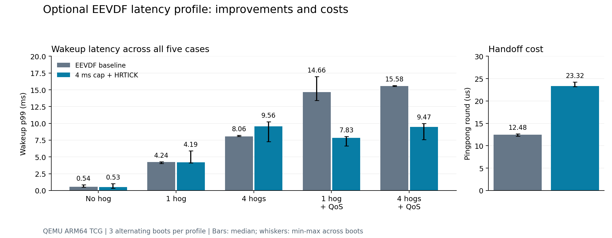

# EEVDF 请求长度与高精度定时器调优实验

2026 年 10 月 30 日补充实验。**可选的 4 ms QoS 请求上限加 HRTICK 方案，将四忙等任务加 QoS 场景的唤醒 p99 从 15.576 ms 降至 9.474 ms，降低 39.2%。** 该结果来自三轮交替启动；改善伴随线程交接成本增加，且部分无 QoS 场景退化。本方案作为实验补丁交付，原快照及初版 CFS 对照保持原样。

## 机制与假设

初版 QoS0 后台请求为 14 ms，QoS5 为 1 ms；HZ=250 的周期 tick 为 4 ms。短前台请求不能消除负 lag 导致的等待。我们比较限制长请求与启用 HRTICK 两个变量，观察能否缩短竞争等待。代码路径支持这一假设，但未采集逐事件 trace，不能把所有延迟变化归因于单一路径。

新增启动参数 `sched_qos_slice_cap_us` 仅限制有效 QoS 等级的请求长度。0 表示保留原映射；允许的非零值为 1000 至 14000 μs。4 ms 上限后的 QoS0 至 6 映射为 4、4、4、2、1.5、1、4 ms，无有效 QoS 的默认请求长度不变。HRTICK 在另一构建中通过 `features.h` 默认启用，要求 `CONFIG_SCHED_HRTICK=y`。在同时包含两个补丁的镜像中，cap=0 仅恢复请求映射，HRTICK 仍然开启。

## 实验方法与构建范围

使用与初版相同的 QEMU ARM64 TCG、4 vCPU、Cortex-A57、1 GiB、HZ=250，比较负载绑在 CPU3。每个延迟场景每次 300 样本，周期 10 ms、运行 0.5 ms；`h1` 和 `h4` 表示 1 或 4 个忙等竞争任务，`qos` 表示给线程设置 QoS 字段。所有时间均为客户机时钟，不能换算为实机应用收益。

在隔离的准备源码及已有对象目录中，完成两次增量 Image 构建：仅加入 cap 的基线镜像，以及 cap 加 HRTICK 镜像。未执行完整操作系统的干净重建。相对仓库快照只改变 fair.c 和 features.h；基准测试代码、样本数和判定阈值均未修改。配置、构建日志、编译器和源文件及镜像 SHA-256 见 [构建来源](evidence/latency-2026-10-30/build-provenance.json)。仓库不分发完整系统磁盘或 Image，需依照复现指南自行构建。

先进行 cap=0、4000、2000 与 HRTICK 开关的六种单次筛选，再选择 4 ms 加 HRTICK 方案做三轮“基线、调优”交替启动。复测基线使用本次 cap-only 镜像且 cap=0，HRTICK 关闭；它与初版 #15 镜像具有相同请求策略，但不是同一二进制。所有运行使用相同用户态磁盘哈希、`-snapshot` 和 `-nic none`；未同时运行其他基准或编译任务。三轮是描述性复测，不足以计算可靠的置信区间或作显著性结论。

## 三轮交替复测的全部延迟场景

以下依次为平均 / p90 / p99，单位 ms。每个数是三次启动对应统计量的中位数，未将 900 样本合并计算分位数。

- `lat_h0`：基线 0.196 / 0.266 / 0.536；调优 0.189 / 0.279 / 0.527。
- `lat_h1`：基线 0.666 / 2.045 / 4.239；调优 0.679 / 3.826 / 4.193。
- `lat_h4`：基线 2.240 / 4.951 / 8.061；调优 2.251 / 4.755 / 9.563。
- `lat_h1_qos`：基线 0.813 / 1.393 / 14.659；调优 0.665 / 0.706 / 7.828。
- `lat_h4_qos`：基线 4.026 / 13.529 / 15.576；调优 2.253 / 4.386 / 9.474。

每次启动的四忙等加 QoS p99：

- 第 1 轮：15.636 → 7.567 ms。
- 第 2 轮：15.576 → 9.980 ms。
- 第 3 轮：15.528 → 9.474 ms。



图中柱为三次启动统计量的中位数，误差线仅表示最小值至最大值，不代表置信区间。原始数值见 [summary.json](evidence/latency-2026-10-30/summary.json)。

## 代价与公平性

线程交接 pingpong 的每轮中位数再取三次启动中位数，由 12.478 μs 增至 23.323 μs，增加 86.9%。这是整轮线程交接时间，不是孤立的上下文切换指令成本。无 QoS 的 `lat_h4` p99 由 8.061 ms 增至 9.563 ms。HRTICK 对所有公平调度任务生效，因此不能把该组合视作普遍加速。

- 基线：nice0 对 nice5 公平性误差（千分比）[0, 9, 1]；nice0 对 nice10 [14, 1, 5]。
- 调优：nice0 对 nice5 公平性误差（千分比）[0, 3, 2]；nice0 对 nice10 [0, 7, 10]。

## 单次筛选和消融结果

以下每项仅一次启动，不用于替代三轮复测。依次列出四忙等加 QoS 的 p99（ms）及 pingpong 中位数（μs）。

- `screen-cap0`：15.476 ms；12.859 μs。
- `screen-cap4000`：8.059 ms；46.571 μs。
- `screen-cap2000`：8.179 ms；136.036 μs。
- `screen-hrtick-cap4000`：6.208 ms；23.832 μs。
- `screen-hrtick-cap2000`：5.599 ms；23.958 μs。
- `screen-hrtick-cap0`：14.046 ms；23.066 μs。

筛选数据保留了所有结果。仅限制请求长度已降低该 QoS 场景的 p99，但 cap-only 4 ms 的 pingpong 出现较大波动；见对应原始日志中的分轮最小值、最大值和中位数。HRTICK-only 的结果用于区分两个变量的影响，单次数据不能证明稳定收益。

## QoS 和不变量回归

4 ms 加 HRTICK 方案共进行了三次独立 QoS 模式启动，均通过原判定阈值以及 fork、reweight 和 AVG done 检查：

- `screen-hrtick-cap4000-qos`：pick 比 off/on=0.95/2.06，启用时 CPU 时间比=0.96；fork 最大 lag=1.061 ms；reweight 在树检查 195 次、最大漂移 8 ns；AVG 2140 次扫描、8594 队列、16 组实体。
- `confirm1-latency-qos`：pick 比 off/on=1.00/2.07，启用时 CPU 时间比=0.98；fork 最大 lag=1.088 ms；reweight 在树检查 202 次、最大漂移 8 ns；AVG 2140 次扫描、8594 队列、16 组实体。
- `confirm2-latency-qos`：pick 比 off/on=1.03/2.07，启用时 CPU 时间比=0.98；fork 最大 lag=1.155 ms；reweight 在树检查 195 次、最大漂移 8 ns；AVG 2140 次扫描、8592 队列、16 组实体。

三次均为 fork 16/16、reweight 200 轮，reweight 越界数和 AVG 三项不一致数均为 0。QoS pick 比通过阈值为 2；本次结果接近阈值，覆盖仍有限。pick 次数比不能解释为吞吐或性能倍数，也不等于实际上下文切换次数。

**2 ms 加 HRTICK 未选用**：其筛选延迟更低，但 QoS pick 比仅 1.35，低于原阈值 2，判为 `inconclusive`，主机脚本按预期返回失败。fork/reweight/AVG 检查仍通过。该结果完整保留，未放宽阈值或删掉失败记录。更短请求会压缩 QoS 等级之间的区别，低延迟与 QoS 区分度需要一起评估。

独立正常启动未传任何测试钩子参数，samgr 就绪，未出现基准记录。所有 17 次运行的输入哈希不变，未检测到内核 BUG/Oops/panic/WARNING/RCU stall。最小系统仍有 watchdog_service 重启等用户态日志，不能称为“无所有告警”。

## 复现与使用范围

将补充补丁应用在本仓库原快照之上，具体覆盖、编译与命令见 [复现指南](复现指南.md#可选调优方案)。组合补丁与分离补丁为两种应用方式，不能重复应用。正常生产启动不应携带测试钩子。

```bash
python3 scripts/summarize_latency.py --output /tmp/latency-summary.json
```

此命令重新验证全部 17 组日志哈希、日志记录、镜像标识、样本完整性、运行隔离和各项判定，再计算汇总；与原 `summarize_bench.py` 分离，不改写初版数据。

当前方案改善相对初版 EEVDF 的指定负载，但仍高于初版 CFS 三次启动的 1.044 ms p99（另一批实验，不能当作同步配对测量）。没有证据表明已超越 CFS、提高应用帧率或达到实机交互优化目标。后续需要用户态 QoS 链路、SMP 迁移、长稳和硬件测试；更大范围的 EEVDF 回移应另行验证。
